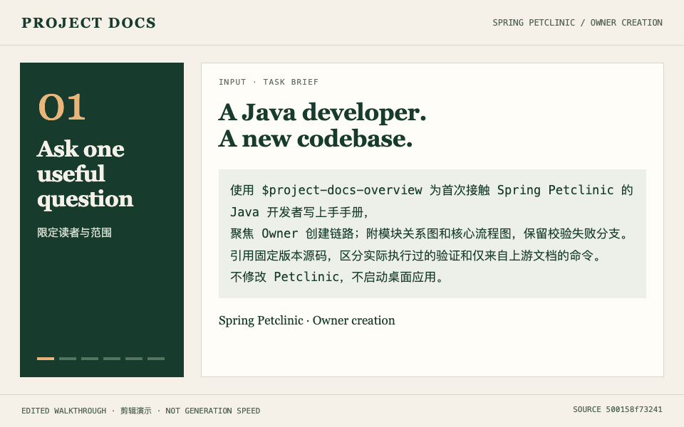

# Project Docs

**Turn an unfamiliar codebase into an onboarding guide, diagrams and a source-backed reading path.**

[中文](README.md) · [See the worked example](docs/examples/petclinic/README.md) · [Install](#quick-start)

Start with the output. This walkthrough uses a pinned revision of the public **Spring Petclinic** sample: task brief → onboarding guide → source evidence → module map → core flow → test results.

[](docs/examples/petclinic/README.md)

24-second loop · Edited walkthrough of existing artifacts, not a real-time generation recording. [Static module map](docs/examples/petclinic/architecture.png) · [Static flow](docs/examples/petclinic/owner-flow.png)

| Input | Output | What you can verify |
| --- | --- | --- |
| A local repository, intended reader and feature | [Onboarding guide (Chinese)](docs/examples/petclinic/developer-guide.md), [module diagram](docs/examples/petclinic/architecture.png), [flow diagram](docs/examples/petclinic/owner-flow.png) | Pinned source links, editable diagrams, checks performed and remaining gaps |

The [case study](docs/examples/petclinic/README.md) includes the request and reproduction steps. This is a code walkthrough of a public sample application, not a production deployment or a claim of measured productivity gains. The example guide is currently in Chinese; this page is the English entry point.

## Quick start

Clone the complete collection and install for Codex:

```bash
git clone https://github.com/ainiaa/skills-project-docs.git
cd skills-project-docs
bash install.sh --host codex
bash install.sh --doctor --host codex
```

The installer links the six Skills, reuses valid required Product dependencies and installs missing renderers. It requires Python 3.11+; renderer requirements and supported host paths are documented in the [installation guide](README.md#安装与升级). For Claude Code, use `--host claude` in both commands. Omitting the host selects both Codex and Claude Code. Other supported hosts: ZCode, DSH, Gemini CLI, Grok Build, pi and OpenCode.

To install only the Skills and required Product dependencies, add `--no-engines` to both commands. This skips renderer installation/checks; diagrams still need a supported renderer when used. Refresh the host's Skill discovery if needed.

In your repository, ask:

```text
Use $project-docs-overview to write an onboarding guide for a Java developer
new to this Spring Boot project. Include a module diagram and one core flow.
Cite source files and separate commands actually verified from unverified steps.
```

For Claude Code, invoke `/project-docs-overview` with the same request.

## Choose a task

| Task | Skill | Deliverable |
| --- | --- | --- |
| Combine several documentation tasks | `project-docs` | Routes to the relevant Skills |
| Understand or onboard to a project | `project-docs-overview` | Overview, feature explanation, onboarding guide; explainer HTML when requested |
| Turn business material into requirements | `project-docs-product` | PRD, acceptance criteria and optional clickable HTML prototype |
| Document Java Spring MVC / Feign or Python FastAPI | `project-docs-api` | Markdown, Postman collection and cURL examples |
| Explain technical structure or behavior | `project-docs-diagram` | Editable Mermaid, PlantUML, draw.io or Archify diagrams and validated exports |
| Coordinate a business goal across delivery stages | `project-docs-lifecycle` | Versioned evidence, traceability and handoffs |

Specify the audience and purpose: a beginner needs concepts and examples; a domain expert needs rules, boundaries and evidence; a decision maker needs tradeoffs. Reader adaptation preserves the same facts, constraints and approval boundaries. See the [shared guidance](references/audience.md).

## Trust and limits

Source anchors and successful rendering do not prove that every architectural interpretation is correct. Generated documents identify assumptions and verification gaps. A prototype is simulated interaction, not a deployed service. Lifecycle records do not grant business approval or production release permission.

The complete repository is required: Skills refer to shared scripts, templates and resources outside each Skill directory. Its `skills/<name>/SKILL.md` layout matches [skills.sh discovery rules](https://github.com/vercel-labs/skills/blob/main/docs/creating-skills.md); discovery is not evidence that copying a single directory provides a working installation. Use this repository's installer. Directory inclusion and install counts are not claimed.

## Try it and share feedback

Try one feature in a repository you may share. Tell us whether installation worked, whether the first document answered your questions, and which claim you could not verify. Remove credentials and private source before opening an issue. See the [sharing and trial kit](docs/SHARING.md) for a short demo outline and feedback questions.

Current release: [v0.10.0](https://github.com/ainiaa/skills-project-docs/releases/tag/v0.10.0). See the [changelog](CHANGELOG.md), [full documentation (Chinese)](README.md) and [license](LICENSE).
