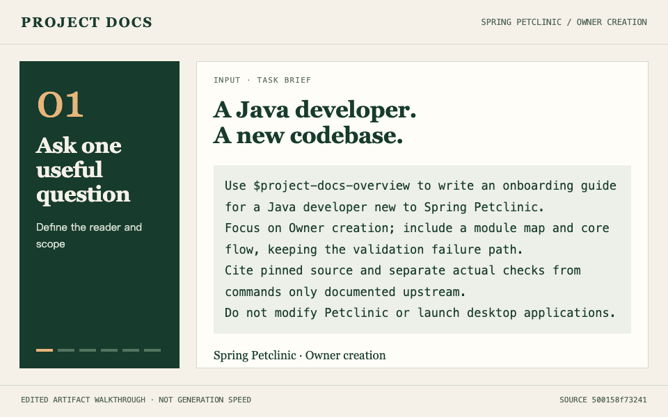

# Project Docs

**Turn an unfamiliar codebase into an onboarding guide, diagrams and a source-backed reading path.**

[中文](README.zh-CN.md) · [See the worked example](docs/examples/petclinic/README.en.md) · [Install](#quick-start)

Start with the output. This walkthrough uses a pinned revision of the public **Spring Petclinic** sample: task brief → onboarding guide → source evidence → module map → core flow → test results.

[](docs/examples/petclinic/README.en.md)

24-second loop · Edited walkthrough of existing artifacts, not a real-time generation recording. [Static module map](docs/examples/petclinic/architecture.png) · [Static flow](docs/examples/petclinic/owner-flow.png)

| Input | Output | What you can verify |
| --- | --- | --- |
| A local repository, intended reader and feature | [Onboarding guide](docs/examples/petclinic/developer-guide.en.md), [module diagram](docs/examples/petclinic/architecture.png), [flow diagram](docs/examples/petclinic/owner-flow.png) | Pinned source links, editable diagrams, checks performed and remaining gaps |

The [case study](docs/examples/petclinic/README.en.md) includes the request and reproduction steps. This is a code walkthrough of a public sample application, not a production deployment or a claim of measured productivity gains. The case study and guide are available in English, with links to their Chinese counterparts.

## Quick start

If this collection was previously installed for Codex with `install.sh`, run the following in the original checkout first. This removes this checkout's Codex links and keeps unrelated Skills and shared dependencies; otherwise Codex can discover both installations:

```bash
bash install.sh --uninstall --host codex
```

Install all six Skills for Codex with Node.js and npm:

```bash
npx skills add ainiaa/skills-project-docs --skill '*' -g -a codex
```

Each Skill includes its shared scripts and resources. Running them requires Python 3.11+; Product validation also requires the [Markdown parser dependency](scripts/requirements-product.txt) in that Python environment. The npx installation does not install those dependencies, the third-party Product Skills or diagram renderers; when drawing, the Skill may install a missing renderer according to its instructions. To switch to the complete installer below, first run `npx skills remove -g -a codex` and select this collection's entries to avoid path conflicts. Replace `'*'` with a name to install one Skill; use `npx skills update -g <installed-skill-name>` to update selected Skills.

Alternatively, run this project's GitHub installer to install the collection and the three Product Skills together:

```bash
npx github:ainiaa/skills-project-docs --with-deps --agent codex --global
```

Omit `--with-deps` to install only the collection, or `--global` for the current project. Use `--agent claude-code` for Claude Code. Run this same command again to update: its project Skill installation record points to the temporary npx cache, so do not rely on `skills update` for those entries. It fetches the latest dependencies from their upstream repositories. To protect existing work, it stops on existing project Skills that are modified or cannot be identified as an identical copy, and on third-party Skills managed elsewhere or modified after installation. Python 3.11+, Git, Node.js, npm and network access are required; diagram engines and Python packages are not installed by this command.

Installations are serialized using `~/.agents/.project-docs-install.lock`. After a forced termination, confirm no installer is running and inspect any `.project-docs-backup-*` directory beside the target Skills before removing a stale lock and retrying.

Clone the complete collection and install for Codex:

```bash
git clone https://github.com/ainiaa/skills-project-docs.git
cd skills-project-docs
bash install.sh --host codex
bash install.sh --doctor --host codex
```

The installer links the six Skills, reuses valid required Product dependencies and installs missing renderers. It requires Python 3.11+; renderer requirements and supported host paths are documented in the [installation guide](README.zh-CN.md#安装与升级). For Claude Code, use `--host claude` in both commands. Omitting the host selects both Codex and Claude Code. Other supported hosts: ZCode, DSH, Gemini CLI, Grok Build, pi and OpenCode.

To install only the Skills and required Product dependencies, add `--no-engines` to both commands. This skips renderer installation/checks; diagrams still need a supported renderer when used. Refresh the host's Skill discovery if needed.

In your repository, ask:

```text
Use $project-docs-overview to write an onboarding guide for a Java developer
new to this Spring Boot project. Include a module diagram and one core flow.
Cite source files and separate commands actually verified from unverified steps.
```

For Claude Code, invoke `/project-docs-overview` with the same request.

## Choose a task

| Task | Skill | Deliverable |
| --- | --- | --- |
| Combine several documentation tasks | `project-docs` | Routes to the relevant Skills |
| Understand or onboard to a project | `project-docs-overview` | Overview, feature explanation, onboarding guide; explainer HTML when requested |
| Turn business material into requirements | `project-docs-product` | PRD, acceptance criteria and optional clickable HTML prototype |
| Document Java Spring MVC / Feign or Python FastAPI | `project-docs-api` | Markdown, Postman collection and cURL examples |
| Explain technical structure or behavior | `project-docs-diagram` | Editable Mermaid, PlantUML, draw.io or Archify diagrams and validated exports |
| Coordinate a business goal across delivery stages | `project-docs-lifecycle` | Versioned evidence, traceability and handoffs |

Specify the audience and purpose: a beginner needs concepts and examples; a domain expert needs rules, boundaries and evidence; a decision maker needs tradeoffs. Reader adaptation preserves the same facts, constraints and approval boundaries. See the [shared guidance](references/audience.md).

## Trust and limits

Source anchors and successful rendering do not prove that every architectural interpretation is correct. Generated documents identify assumptions and verification gaps. A prototype is simulated interaction, not a deployed service. Lifecycle records do not grant business approval or production release permission.

The npx distribution includes a snapshot of the shared scripts, templates and resources in each Skill. External tools and Product dependencies are managed separately; the repository installer can set them up.

## Try it and share feedback

Try one feature in a repository you may share. Tell us whether installation worked, whether the first document answered your questions, and which claim you could not verify. Remove credentials and private source before opening an issue. See the [sharing and trial kit](docs/SHARING.md) for a short demo outline and feedback questions.

## Chinese documentation and legacy links

The [complete Chinese guide](README.zh-CN.md) retains the detailed installation, host support and reference documentation. Previous Chinese section links remain available below.

<details>
<summary>Previous Chinese section links / 中文旧章节导航</summary>

- <a id="快速开始"></a>[快速开始](README.zh-CN.md#快速开始)
- <a id="选哪个-skill"></a>[选哪个 Skill](README.zh-CN.md#选哪个-skill)
- <a id="按读者与用途交付"></a>[按读者与用途交付](README.zh-CN.md#按读者与用途交付)
- <a id="eli5-与多场景图解"></a>[ELI5 与多场景图解](README.zh-CN.md#eli5-与多场景图解)
- <a id="为什么会有它"></a>[为什么会有它](README.zh-CN.md#为什么会有它)
- <a id="产品需求与可点击原型"></a>[产品需求与可点击原型](README.zh-CN.md#产品需求与可点击原型)
- <a id="prd-与增量需求"></a>[PRD 与增量需求](README.zh-CN.md#prd-与增量需求)
- <a id="可点击原型与实际验收"></a>[可点击原型与实际验收](README.zh-CN.md#可点击原型与实际验收)
- <a id="结构校验与历史修订"></a>[结构校验与历史修订](README.zh-CN.md#结构校验与历史修订)
- <a id="上游能力与验证边界"></a>[上游能力与验证边界](README.zh-CN.md#上游能力与验证边界)
- <a id="能力与边界"></a>[能力与边界](README.zh-CN.md#能力与边界)
- <a id="四个渲染引擎分别能画什么"></a>[四个渲染引擎分别能画什么](README.zh-CN.md#四个渲染引擎分别能画什么)
- <a id="一页说明archify-explainer"></a>[一页说明（Archify explainer）](README.zh-CN.md#一页说明archify-explainer)
- <a id="安装与升级"></a>[安装与升级](README.zh-CN.md#安装与升级)
- <a id="宿主支持"></a>[宿主支持](README.zh-CN.md#宿主支持)
- <a id="渲染引擎要另外安装吗"></a>[渲染引擎要另外安装吗？](README.zh-CN.md#渲染引擎要另外安装吗)
- <a id="使用-project-docs-api"></a>[使用 Project Docs API](README.zh-CN.md#使用-project-docs-api)
- <a id="使用-project-docs-overview"></a>[使用 Project Docs Overview](README.zh-CN.md#使用-project-docs-overview)
- <a id="使用-project-docs-diagram"></a>[使用 Project Docs Diagram](README.zh-CN.md#使用-project-docs-diagram)
- <a id="引擎如何参与生成"></a>[引擎如何参与生成](README.zh-CN.md#引擎如何参与生成)
- <a id="文档"></a>[文档](README.zh-CN.md#文档)
- <a id="开发与验证"></a>[开发与验证](README.zh-CN.md#开发与验证)
- <a id="参考与鸣谢"></a>[参考与鸣谢](README.zh-CN.md#参考与鸣谢)
- <a id="许可与反馈"></a>[许可与反馈](README.zh-CN.md#许可与反馈)
- <a id="生命周期首个切片"></a>[生命周期首个切片](README.zh-CN.md#生命周期首个切片)

</details>

Current release: [v0.11.1](https://github.com/ainiaa/skills-project-docs/releases/tag/v0.11.1). See the [changelog](CHANGELOG.md), [full documentation (Chinese)](README.zh-CN.md) and [license](LICENSE).
