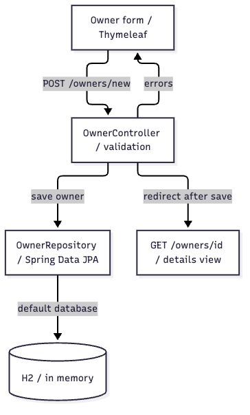

# Case study: onboarding to Spring Petclinic through Owner creation

[English homepage](../../../README.md) · [中文](README.md) · [Read the onboarding guide](developer-guide.en.md)

This is a source walkthrough of a public Java application using Project Docs Overview and Diagram. The reader knows Java and Spring but is new to Petclinic. It answers where to start reading, which components create an owner, and what happens to invalid input before expanding into setup and testing.

## Input

Repository: [spring-projects/spring-petclinic](https://github.com/spring-projects/spring-petclinic/tree/500158f732419217507c7656904b8e6aa1bcc0d6). The source is pinned to `500158f732419217507c7656904b8e6aa1bcc0d6` so diagrams and citations remain tied to the version inspected.

Task brief adapted for this demonstration, not a verbatim user quote:

```text
Use $project-docs-overview to write an onboarding guide for a Java developer new to Spring Petclinic.
Focus on Owner creation; include a module map and core flow, keeping the validation failure path.
Cite pinned source and separate actual checks from commands only documented upstream.
Do not modify Petclinic or launch desktop applications.
```

## From code to artifacts

1. Clone the public repository and pin the commit. It had no CodeGraph index; none was created for this case.
2. Use the existing `project_doc_context.py` once to focus on OwnerController, OwnerRepository, PetClinicApplication and application.properties. Check the form, field constraints, save call, redirect and relevant tests.
3. Follow the onboarding-guide template and place pinned source links beside conclusions. Preserve the Controller's direct Repository call instead of adding an imaginary Service or microservice layer.
4. Author two Mermaid diagrams with source anchors for each statement. Export PNGs through the existing `render_native_diagram.py` and official engine, then inspect labels, arrows and branches.
5. Run document validation and repository link/resource regressions. The recorded upstream OwnerControllerTests run passed all 18 tests. Results are distinguished in the [verification record](verification.json).

The artifacts were prepared in a supervised chat using the Skill workflow. This is not an unattended benchmark or a measured time-saving claim. Upstream business source was not copied into this repository. The English edition uses the same evidence and results as the Chinese edition; translation is not a new test run.

## View the outputs

| Artifact | Purpose |
| --- | --- |
| [developer-guide.en.md](developer-guide.en.md) | Nine-part onboarding guide: prerequisites, startup, operations, rules, tests, reading path and troubleshooting |
| [architecture.png](architecture.png) · [source](architecture.mmd) · [evidence](architecture.evidence.json) | Module relationships scoped to Owner creation, not the whole system |
| [owner-flow.png](owner-flow.png) · [source](owner-flow.mmd) · [evidence](owner-flow.evidence.json) | Invalid input returns to the form; valid input is saved and redirects |
| [verification.json](verification.json) · [test results](controller-test-results.json) | Pinned source, actual checks, 18 Controller tests and unverified areas |



## Reproduce the walkthrough

Install Project Docs using the [English quick start](../../../README.md#quick-start), then clone and pin the target:

```bash
git clone https://github.com/spring-projects/spring-petclinic.git
cd spring-petclinic
git checkout 500158f732419217507c7656904b8e6aa1bcc0d6
```

Ask your coding agent to perform the task above from that directory. Choose an output location outside Petclinic to avoid adding generated documents to the source under analysis. Model output and local environments vary; byte-for-byte reproduction is not promised.

Run the following from the **Project Docs root**, replacing placeholder paths:

```bash
python3 scripts/project_doc_context.py --source /path/to/spring-petclinic \
  --focus OwnerController --focus OwnerRepository --focus PetClinicApplication \
  --focus application.properties --output /path/to/work/focus.json
python3 scripts/validate_project_doc.py --kind guide \
  --file docs/examples/petclinic/developer-guide.md --source /path/to/spring-petclinic
python3 scripts/render_native_diagram.py --engine mermaid \
  --input docs/examples/petclinic/owner-flow.mmd --output /path/to/work/flow \
  --source-repo /path/to/spring-petclinic \
  --evidence docs/examples/petclinic/owner-flow.evidence.json --export png
```

The fixed-template validator in the second command checks the original Chinese guide. The English guide keeps the same nine sections in translation; its sources and content are checked against that guide rather than claiming that a Chinese-heading validator validates English headings.

To check the module map, replace `owner-flow` with `architecture` in the final command and choose another output directory. Rendering uses a headless browser; neither the Petclinic Web application nor draw.io Desktop needs to be launched.

## What this demonstrates

The artifacts record source inspection, writing, rendering and review of one pinned revision. A valid anchor does not prove an interpretation correct, and Controller tests do not verify database persistence or browser end-to-end behavior. Application startup, container integration, human reader trials and production deployment were not performed.

Spring Petclinic is a public Spring sample application under [Apache-2.0](https://github.com/spring-projects/spring-petclinic/blob/500158f732419217507c7656904b8e6aa1bcc0d6/LICENSE.txt). This independent documentation example does not imply upstream endorsement.
