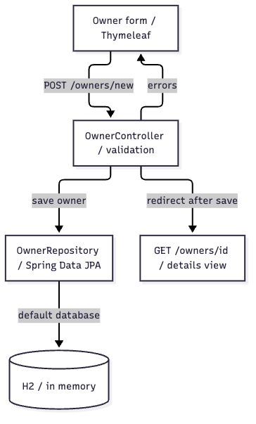

# 案例：接手 Spring Petclinic，先读懂 Owner 创建链路

[返回首页](../../../README.md) · [English entry](../../../README.en.md) · [直接看上手手册](developer-guide.md)

这是 Project Docs Overview 与 Diagram 对一个公开 Java 项目的实际代码走读。目标读者会 Java / Spring，但没接触过该项目。先回答“从哪里开始读、创建主人经过哪些组件、输入不合法会怎样”，再展开安装和测试。

## 输入

项目：[spring-projects/spring-petclinic](https://github.com/spring-projects/spring-petclinic/tree/500158f732419217507c7656904b8e6aa1bcc0d6)。固定源码提交 `500158f732419217507c7656904b8e6aa1bcc0d6`，避免上游更新后图与来源错位。

本次案例任务说明（按本轮目标整理，非用户逐字原话）：

```text
使用 $project-docs-overview 为首次接触 Spring Petclinic 的 Java 开发者写上手手册，
聚焦 Owner 创建链路；附模块关系图和核心流程图，保留校验失败分支。
引用固定版本源码，区分实际执行过的验证和仅来自上游文档的命令。
不修改 Petclinic，不启动桌面应用。
```

## 从代码到成品

1. 克隆公开仓库并固定提交。目标仓库没有 CodeGraph 索引，本次未创建索引。
2. 用现有 `project_doc_context.py` 一次聚焦 OwnerController、OwnerRepository、PetClinicApplication 和 application.properties；逐项核对表单、字段规则、保存、重定向及相关测试。
3. 遵循现有上手手册模板编写正文，将固定提交的源码链接放在结论附近。发现 Controller 直接访问 Repository，保留实际结构；没有加入不存在的 Service 或微服务。
4. 用 Mermaid 编写两张图，逐条关联源码锚点。通过现有 `render_native_diagram.py` 调用官方引擎导出 PNG，再核对文字、箭头和分支。
5. 运行现有文档校验器与本仓链接/资源回归；另实际运行上游 OwnerControllerTests，18 项全部通过。各类结果分别记录，见[验证记录](verification.json)。

本次由当前会话执行 Skill 流程并整理成品，不是无人干预的基准评测，也没有测量“节省了多少时间”。未复制上游业务源码到本仓。

## 直接查看成果

| 文件 | 用途 |
| --- | --- |
| [developer-guide.md](developer-guide.md) | 九部分上手手册：环境、启动、操作、规则、测试、阅读路线与排障 |
| [architecture.png](architecture.png) · [图源](architecture.mmd) · [证据](architecture.evidence.json) | Owner 创建范围的模块关系，非全系统架构 |
| [owner-flow.png](owner-flow.png) · [图源](owner-flow.mmd) · [证据](owner-flow.evidence.json) | 字段校验失败回表单；成功保存并重定向 |
| [verification.json](verification.json) · [测试结果](controller-test-results.json) | 固定源码、实际检查、18 项 Controller 测试及未验证项 |



## 复现方式

先按[首页](../../../README.md#快速开始)安装 Project Docs，再克隆并固定目标仓库：

```bash
git clone https://github.com/spring-projects/spring-petclinic.git
cd spring-petclinic
git checkout 500158f732419217507c7656904b8e6aa1bcc0d6
```

在该目录向宿主提出上面的请求。输出位置选在 Petclinic 目录外，避免生成内容污染被分析的源码。模型输出与机器环境可能不同，不保证逐字重现。

下列命令在 **Project Docs 根目录**运行，将占位路径替换为本机实际路径：

```bash
python3 scripts/project_doc_context.py --source /path/to/spring-petclinic \
  --focus OwnerController --focus OwnerRepository --focus PetClinicApplication \
  --focus application.properties --output /path/to/work/focus.json
python3 scripts/validate_project_doc.py --kind guide \
  --file docs/examples/petclinic/developer-guide.md --source /path/to/spring-petclinic
python3 scripts/render_native_diagram.py --engine mermaid \
  --input docs/examples/petclinic/owner-flow.mmd --output /path/to/work/flow \
  --source-repo /path/to/spring-petclinic \
  --evidence docs/examples/petclinic/owner-flow.evidence.json --export png
```

模块图复验时将最后一条命令中的 `owner-flow` 换成 `architecture`，另选输出目录。渲染会使用无界面浏览器；不需启动 Petclinic 或 draw.io 桌面程序。

## 能证明什么

这些产物证明本次对固定版本做过取证、写作、渲染和核对。源码锚点存在不等于业务解释必然正确，Controller 测试也不等于真实持久化或浏览器端到端验收。没有启动 Web 应用、运行容器集成测试、真人试读或生产部署。

Spring Petclinic 是 Spring 项目的公开示例应用，遵循其 [Apache-2.0 许可](https://github.com/spring-projects/spring-petclinic/blob/500158f732419217507c7656904b8e6aa1bcc0d6/LICENSE.txt)。本案例为独立文档演示，不代表上游背书。
