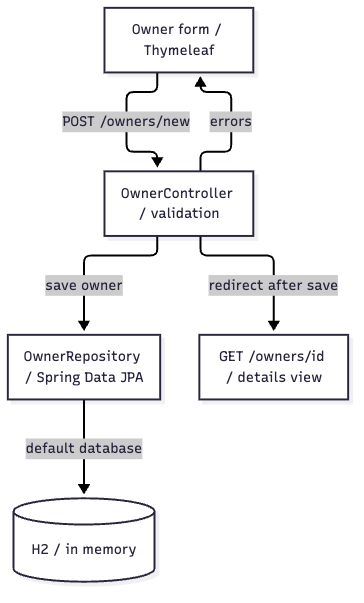
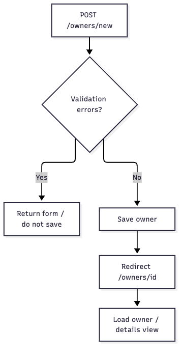

# Spring Petclinic: start with the Owner creation path

> Source commit: 500158f732419217507c7656904b8e6aa1bcc0d6
> Author: Jeff.Liu · Audience: Java / Spring developers new to Petclinic.

[English case study](README.en.md) · [中文](developer-guide.md)

This source walkthrough covers default setup and Owner creation in a public sample application. Upstream source was not modified. It is not a customer production case or an official Spring endorsement. Verification statements refer to the existing case run, not a fresh run during translation.

## 1. Project overview

Petclinic is a sample application for managing owners, pets, visits and vets. This guide follows owner creation: invalid input returns to the form; valid input is saved and redirects to details. The Controller calls the JPA Repository directly.



The map covers Owner creation, not the complete Petclinic architecture. Thymeleaf supplies the form, OwnerController handles validation and view outcomes, and OwnerRepository provides JPA data access. The default database is in-memory H2. [Editable source](architecture.mmd) · [Source anchors](architecture.evidence.json).

Sources: [application overview](https://github.com/spring-projects/spring-petclinic/blob/500158f732419217507c7656904b8e6aa1bcc0d6/readme.md#L14), [OwnerController](https://github.com/spring-projects/spring-petclinic/blob/500158f732419217507c7656904b8e6aa1bcc0d6/src/main/java/org/springframework/samples/petclinic/owner/OwnerController.java#L72), [OwnerRepository](https://github.com/spring-projects/spring-petclinic/blob/500158f732419217507c7656904b8e6aa1bcc0d6/src/main/java/org/springframework/samples/petclinic/owner/OwnerRepository.java#L36), [default database](https://github.com/spring-projects/spring-petclinic/blob/500158f732419217507c7656904b8e6aa1bcc0d6/readme.md#L64).

## 2. Prerequisites

| Requirement | Evidence and notes |
| --- | --- |
| JDK 17 or newer, Git | [README](https://github.com/spring-projects/spring-petclinic/blob/500158f732419217507c7656904b8e6aa1bcc0d6/readme.md#L14); [pom.xml](https://github.com/spring-projects/spring-petclinic/blob/500158f732419217507c7656904b8e6aa1bcc0d6/pom.xml#L19) targets Java 17 |
| Maven Wrapper | The project supplies `mvnw`; [wrapper configuration](https://github.com/spring-projects/spring-petclinic/blob/500158f732419217507c7656904b8e6aa1bcc0d6/.mvn/wrapper/maven-wrapper.properties#L1) pins its distribution. First use requires network access |
| Default database | H2 is sufficient for this route; MySQL or PostgreSQL need not be deployed first. See [database documentation](https://github.com/spring-projects/spring-petclinic/blob/500158f732419217507c7656904b8e6aa1bcc0d6/readme.md#L64) |

The recorded case used an existing JDK 21 installation. The project's Java target was unchanged, and no desktop software was installed or launched.

## 3. Setup and startup

Use the same source revision as this guide:

```bash
git clone https://github.com/spring-projects/spring-petclinic.git
cd spring-petclinic
git checkout 500158f732419217507c7656904b8e6aa1bcc0d6
./mvnw spring-boot:run
```

Run from the Petclinic root. The documented success signal is the application at `http://localhost:8080/`. Startup is an upstream instruction, not an observed success in this case: the Web application was not started. Gradle users can consult the upstream `./gradlew bootRun` alternative.

Sources: [startup instructions](https://github.com/spring-projects/spring-petclinic/blob/500158f732419217507c7656904b8e6aa1bcc0d6/readme.md#L14), [application entry](https://github.com/spring-projects/spring-petclinic/blob/500158f732419217507c7656904b8e6aa1bcc0d6/src/main/java/org/springframework/samples/petclinic/PetClinicApplication.java#L28).

## 4. Common tasks

| Task | Entry or steps | Outcome and boundary |
| --- | --- | --- |
| Create an owner | GET `/owners/new`, then POST the form to the same path | Save only after successful validation; errors return the form |
| Find owners | GET `/owners`, filtering by last-name prefix | No match returns the search page, one match redirects to details, multiple matches show a paginated list |
| View an owner | GET `/owners/{ownerId}` | A found owner produces the detail view; a missing owner throws an exception. This method alone does not establish the final HTTP status |



The flow expands field validation and navigation after saving. Database failures are not caught separately inside this method; the image is not a complete recovery design. [Editable flow](owner-flow.mmd) · [Source anchors](owner-flow.evidence.json).

Sources: [creation](https://github.com/spring-projects/spring-petclinic/blob/500158f732419217507c7656904b8e6aa1bcc0d6/src/main/java/org/springframework/samples/petclinic/owner/OwnerController.java#L72), [search](https://github.com/spring-projects/spring-petclinic/blob/500158f732419217507c7656904b8e6aa1bcc0d6/src/main/java/org/springframework/samples/petclinic/owner/OwnerController.java#L94), [five records per page](https://github.com/spring-projects/spring-petclinic/blob/500158f732419217507c7656904b8e6aa1bcc0d6/src/main/java/org/springframework/samples/petclinic/owner/OwnerController.java#L141), [details](https://github.com/spring-projects/spring-petclinic/blob/500158f732419217507c7656904b8e6aa1bcc0d6/src/main/java/org/springframework/samples/petclinic/owner/OwnerController.java#L178).

## 5. Development conventions

This path returns MVC view names and redirects rather than JSON REST responses. Read form → Controller → Repository before changing it. Owner address is required and limited to 255 characters; city is required and limited to 80 characters; telephone must contain 10 digits. Name rules come from Person. The binder disallows `id` and `*.id`. These are implementation facts, not a substitute for product policy or permission design in a real project.

Team branching and review rules were not verified in this case and are not invented here.

Sources: [form](https://github.com/spring-projects/spring-petclinic/blob/500158f732419217507c7656904b8e6aa1bcc0d6/src/main/resources/templates/owners/createOrUpdateOwnerForm.html#L8), [Owner fields](https://github.com/spring-projects/spring-petclinic/blob/500158f732419217507c7656904b8e6aa1bcc0d6/src/main/java/org/springframework/samples/petclinic/owner/Owner.java#L48), [Person](https://github.com/spring-projects/spring-petclinic/blob/500158f732419217507c7656904b8e6aa1bcc0d6/src/main/java/org/springframework/samples/petclinic/model/Person.java#L28), [binding restrictions](https://github.com/spring-projects/spring-petclinic/blob/500158f732419217507c7656904b8e6aa1bcc0d6/src/main/java/org/springframework/samples/petclinic/owner/OwnerController.java#L59).

## 6. Tests and verification

From the Petclinic root, the relevant Controller test command is:

```bash
./mvnw -q -Dtest=OwnerControllerTests test
```

The recorded run of `OwnerControllerTests` at the pinned commit passed 18 tests: zero failures, errors or skips. Scenarios include successful creation, missing required fields and an over-length city. See the [actual test summary](controller-test-results.json) and [verification record](verification.json). These tests use MockMvc and a mocked Repository; they do not prove real persistence or browser E2E behavior.

An earlier local dependency download failed during TLS negotiation; another attempt waited on a local proxy. The successful invocation cleared proxy properties for that process only, leaving certificate validation enabled. Normal working network environments do not need this local adjustment; global Maven and proxy settings were unchanged:

```bash
JAVA_TOOL_OPTIONS='-Djava.awt.headless=true -Djava.net.useSystemProxies=false -Dhttp.proxyHost= -Dhttps.proxyHost= -DsocksProxyHost=' \
./mvnw -B -ntp -Dtest=OwnerControllerTests test
```

Upstream CI runs `./mvnw -B verify`; that does not mean the full suite was run here. MySQL / PostgreSQL integration tests use containers and were outside this walkthrough.

Sources: [OwnerControllerTests](https://github.com/spring-projects/spring-petclinic/blob/500158f732419217507c7656904b8e6aa1bcc0d6/src/test/java/org/springframework/samples/petclinic/owner/OwnerControllerTests.java#L106), [Maven CI](https://github.com/spring-projects/spring-petclinic/blob/500158f732419217507c7656904b8e6aa1bcc0d6/.github/workflows/maven-build.yml#L28), [test applications](https://github.com/spring-projects/spring-petclinic/blob/500158f732419217507c7656904b8e6aa1bcc0d6/readme.md#L99).

## 7. Reading path

| Order | Entry or file | Question to answer |
| --- | --- | --- |
| 1 | [PetClinicApplication](https://github.com/spring-projects/spring-petclinic/blob/500158f732419217507c7656904b8e6aa1bcc0d6/src/main/java/org/springframework/samples/petclinic/PetClinicApplication.java#L28) | Where does Spring Boot start? |
| 2 | [Creation form](https://github.com/spring-projects/spring-petclinic/blob/500158f732419217507c7656904b8e6aa1bcc0d6/src/main/resources/templates/owners/createOrUpdateOwnerForm.html#L8) | Which fields does the user submit? |
| 3 | [processCreationForm](https://github.com/spring-projects/spring-petclinic/blob/500158f732419217507c7656904b8e6aa1bcc0d6/src/main/java/org/springframework/samples/petclinic/owner/OwnerController.java#L77) | Where do invalid and valid submissions go? |
| 4 | [Owner](https://github.com/spring-projects/spring-petclinic/blob/500158f732419217507c7656904b8e6aa1bcc0d6/src/main/java/org/springframework/samples/petclinic/owner/Owner.java#L48) / [Person](https://github.com/spring-projects/spring-petclinic/blob/500158f732419217507c7656904b8e6aa1bcc0d6/src/main/java/org/springframework/samples/petclinic/model/Person.java#L28) | Where are validation constraints declared? |
| 5 | [OwnerRepository](https://github.com/spring-projects/spring-petclinic/blob/500158f732419217507c7656904b8e6aa1bcc0d6/src/main/java/org/springframework/samples/petclinic/owner/OwnerRepository.java#L36) | Which interface handles saving and querying? |
| 6 | [Controller tests](https://github.com/spring-projects/spring-petclinic/blob/500158f732419217507c7656904b8e6aa1bcc0d6/src/test/java/org/springframework/samples/petclinic/owner/OwnerControllerTests.java#L114) | Which inputs succeed or return the form? |

## 8. Documentation index

| Resource | Purpose |
| --- | --- |
| [Upstream README](https://github.com/spring-projects/spring-petclinic/blob/500158f732419217507c7656904b8e6aa1bcc0d6/readme.md#L1) | Full setup and database choices; consult current upstream documentation for later revisions |
| [application.properties](https://github.com/spring-projects/spring-petclinic/blob/500158f732419217507c7656904b8e6aa1bcc0d6/src/main/resources/application.properties#L1) | Default database initialization, JPA, logging and monitoring configuration |
| [Case study](README.en.md) | Task brief, evidence workflow, artifacts and verification boundaries |

## 9. Troubleshooting

| Symptom | Check first | Boundary and next step |
| --- | --- | --- |
| Submission returns to the form | Required fields, city/address length and telephone format | Compare constraints and Controller tests; staying on the form does not mean the save succeeded |
| Owner details are missing | Whether the given `ownerId` exists | The Controller throws an exception; inspect global handling or an actual request to establish the final page and status |
| Default data disappears after restart | Whether in-memory H2 is still selected | For persistence, assess mysql/postgres profiles using upstream instructions; switching databases was not verified here |
| First Maven invocation fails | Wrapper download, dependency repositories and network connectivity | Preserve the actual error rather than claiming that business tests ran and failed or passed |

Sources: [validation errors](https://github.com/spring-projects/spring-petclinic/blob/500158f732419217507c7656904b8e6aa1bcc0d6/src/main/java/org/springframework/samples/petclinic/owner/OwnerController.java#L79), [missing owner](https://github.com/spring-projects/spring-petclinic/blob/500158f732419217507c7656904b8e6aa1bcc0d6/src/main/java/org/springframework/samples/petclinic/owner/OwnerController.java#L181), [database configuration](https://github.com/spring-projects/spring-petclinic/blob/500158f732419217507c7656904b8e6aa1bcc0d6/readme.md#L64), [wrapper URL](https://github.com/spring-projects/spring-petclinic/blob/500158f732419217507c7656904b8e6aa1bcc0d6/.mvn/wrapper/maven-wrapper.properties#L3).
