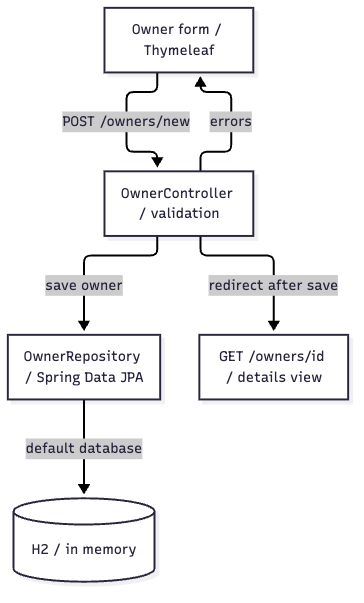
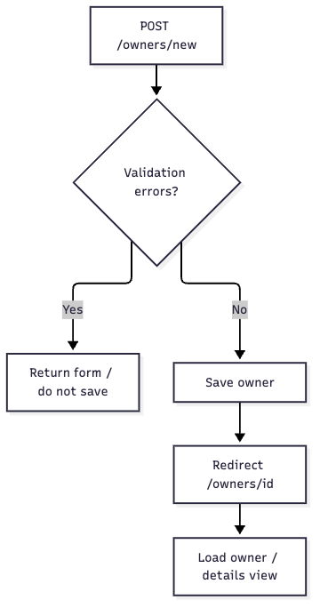

# Spring Petclinic：从 Owner 创建链路开始上手

> 源代码版本：500158f732419217507c7656904b8e6aa1bcc0d6
> 作者：Jeff.Liu · 读者：熟悉 Java / Spring、首次接触 Petclinic 的开发者。

这是基于公开示例应用的代码走读成品，聚焦默认运行方式及 Owner 创建链路。没有修改上游源码。它不是客户生产案例，也不代表 Spring 官方认可。

## 1. 项目总览

Petclinic 是宠物诊所管理示例，包含主人、宠物、就诊记录及兽医等对象。本手册从新增主人入手：表单提交到 MVC Controller，校验失败返回表单，成功保存并跳转详情。当前链路由 Controller 直接调用 Spring Data JPA Repository；没有凭空补一层 Service。



这是 Owner 创建范围的模块关系图，不是整个 Petclinic 的完整架构。Thymeleaf 提供表单，OwnerController 组织校验及视图结果，OwnerRepository 提供 JPA 数据访问；默认使用内存 H2。[可编辑图源](architecture.mmd) · [源码锚点](architecture.evidence.json)。

来源：[应用说明](https://github.com/spring-projects/spring-petclinic/blob/500158f732419217507c7656904b8e6aa1bcc0d6/readme.md#L14)、[OwnerController](https://github.com/spring-projects/spring-petclinic/blob/500158f732419217507c7656904b8e6aa1bcc0d6/src/main/java/org/springframework/samples/petclinic/owner/OwnerController.java#L72)、[OwnerRepository](https://github.com/spring-projects/spring-petclinic/blob/500158f732419217507c7656904b8e6aa1bcc0d6/src/main/java/org/springframework/samples/petclinic/owner/OwnerRepository.java#L36)、[默认数据库](https://github.com/spring-projects/spring-petclinic/blob/500158f732419217507c7656904b8e6aa1bcc0d6/readme.md#L64)。

## 2. 环境准备

| 要求 | 依据与注意事项 |
| --- | --- |
| JDK 17 或以上、Git | [readme.md](https://github.com/spring-projects/spring-petclinic/blob/500158f732419217507c7656904b8e6aa1bcc0d6/readme.md#L14)，[pom.xml](https://github.com/spring-projects/spring-petclinic/blob/500158f732419217507c7656904b8e6aa1bcc0d6/pom.xml#L19) 将 Java 目标设为 17 |
| Maven Wrapper | 项目提供 `mvnw`；[Wrapper 配置](https://github.com/spring-projects/spring-petclinic/blob/500158f732419217507c7656904b8e6aa1bcc0d6/.mvn/wrapper/maven-wrapper.properties#L1) 指定分发版本，首次执行需要网络 |
| 默认数据库 | 使用 H2；不必为了这条上手路线先部署 MySQL 或 PostgreSQL，见 [数据库说明](https://github.com/spring-projects/spring-petclinic/blob/500158f732419217507c7656904b8e6aa1bcc0d6/readme.md#L64) |

本次本机已有 JDK 21；未更改项目 Java 目标，也未安装或启动桌面软件。

## 3. 安装与启动

先固定与本手册相同的源码版本：

```bash
git clone https://github.com/spring-projects/spring-petclinic.git
cd spring-petclinic
git checkout 500158f732419217507c7656904b8e6aa1bcc0d6
./mvnw spring-boot:run
```

运行目录为 Petclinic 根目录。预期启动后访问 `http://localhost:8080/`。这是上游提供的启动方式，本次没有启动 Web 应用，不将它记为已验证启动。Gradle 用户可参考上游的 `./gradlew bootRun`。

来源：[启动说明](https://github.com/spring-projects/spring-petclinic/blob/500158f732419217507c7656904b8e6aa1bcc0d6/readme.md#L14)、[应用入口](https://github.com/spring-projects/spring-petclinic/blob/500158f732419217507c7656904b8e6aa1bcc0d6/src/main/java/org/springframework/samples/petclinic/PetClinicApplication.java#L28)。

## 4. 常用操作

| 任务 | 入口或步骤 | 结果与边界 |
| --- | --- | --- |
| 新增主人 | GET `/owners/new`，再提交同路径的表单 | 字段校验通过才保存；失败回到表单 |
| 查询主人 | GET `/owners`，按姓氏前缀筛选 | 无匹配返回查找页，一个结果跳详情，多个结果分页展示 |
| 查看主人 | GET `/owners/{ownerId}` | 查到后返回详情视图；不存在时抛出异常，不能凭这段代码推断最终 HTTP 状态 |



图中只展开字段校验分支和保存后的页面流转；数据库故障等运行异常没有在此方法内单独捕获，不能把图当作完整故障恢复方案。[流程图源](owner-flow.mmd) · [源码锚点](owner-flow.evidence.json)。

来源：[创建](https://github.com/spring-projects/spring-petclinic/blob/500158f732419217507c7656904b8e6aa1bcc0d6/src/main/java/org/springframework/samples/petclinic/owner/OwnerController.java#L72)、[查询](https://github.com/spring-projects/spring-petclinic/blob/500158f732419217507c7656904b8e6aa1bcc0d6/src/main/java/org/springframework/samples/petclinic/owner/OwnerController.java#L94)、[分页每页 5 条](https://github.com/spring-projects/spring-petclinic/blob/500158f732419217507c7656904b8e6aa1bcc0d6/src/main/java/org/springframework/samples/petclinic/owner/OwnerController.java#L141)、[详情](https://github.com/spring-projects/spring-petclinic/blob/500158f732419217507c7656904b8e6aa1bcc0d6/src/main/java/org/springframework/samples/petclinic/owner/OwnerController.java#L178)。

## 5. 开发约定

本链路使用 MVC 视图名和重定向，不是 JSON REST 接口。修改前先沿表单 → Controller → Repository 阅读。Owner 的地址必填且最多 255 字符，城市必填且最多 80 字符，电话要求 10 位数字；姓名规则来自父类 Person。绑定器禁止直接绑定 `id` 和 `*.id`。这些是当前实现事实，不替代真实项目的产品口径或权限设计。

正式团队分支及评审约定：本次未核实，不自行补造。

来源：[表单](https://github.com/spring-projects/spring-petclinic/blob/500158f732419217507c7656904b8e6aa1bcc0d6/src/main/resources/templates/owners/createOrUpdateOwnerForm.html#L8)、[Owner 字段](https://github.com/spring-projects/spring-petclinic/blob/500158f732419217507c7656904b8e6aa1bcc0d6/src/main/java/org/springframework/samples/petclinic/owner/Owner.java#L48)、[Person](https://github.com/spring-projects/spring-petclinic/blob/500158f732419217507c7656904b8e6aa1bcc0d6/src/main/java/org/springframework/samples/petclinic/model/Person.java#L28)、[绑定限制](https://github.com/spring-projects/spring-petclinic/blob/500158f732419217507c7656904b8e6aa1bcc0d6/src/main/java/org/springframework/samples/petclinic/owner/OwnerController.java#L59)。

## 6. 测试与验证

在 Petclinic 根目录运行相关 Controller 测试：

```bash
./mvnw -q -Dtest=OwnerControllerTests test
```

本次在固定提交上实际运行了 `OwnerControllerTests`：18 项通过，失败 0、错误 0、跳过 0。覆盖创建成功、缺少必填项、城市超过长度上限等场景，详见[实际测试结果摘要](controller-test-results.json)和[案例验证记录](verification.json)。这组测试使用 MockMvc 和 mock Repository，不证明真实数据库持久化或浏览器端到端通过。

此前本机下载曾出现 TLS 握手失败，后续又观察到 Maven 经本地代理等待依赖。本次仅对该次调用清空代理属性，实际成功命令如下；已有正常网络环境时无需套用这一配置，未改全局 Maven/代理设置：

```bash
JAVA_TOOL_OPTIONS='-Djava.awt.headless=true -Djava.net.useSystemProxies=false -Dhttp.proxyHost= -Dhttps.proxyHost= -DsocksProxyHost=' \
./mvnw -B -ntp -Dtest=OwnerControllerTests test
```

上游 CI 使用 `./mvnw -B verify`；这不是本次执行全量测试的声明。MySQL / PostgreSQL 集成测试涉及容器，未纳入此次代码走读。

来源：[OwnerControllerTests](https://github.com/spring-projects/spring-petclinic/blob/500158f732419217507c7656904b8e6aa1bcc0d6/src/test/java/org/springframework/samples/petclinic/owner/OwnerControllerTests.java#L106)、[Maven CI](https://github.com/spring-projects/spring-petclinic/blob/500158f732419217507c7656904b8e6aa1bcc0d6/.github/workflows/maven-build.yml#L28)、[上游测试应用说明](https://github.com/spring-projects/spring-petclinic/blob/500158f732419217507c7656904b8e6aa1bcc0d6/readme.md#L99)。

## 7. 推荐阅读路线

| 顺序 | 位置 | 先回答的问题 |
| --- | --- | --- |
| 1 | [PetClinicApplication](https://github.com/spring-projects/spring-petclinic/blob/500158f732419217507c7656904b8e6aa1bcc0d6/src/main/java/org/springframework/samples/petclinic/PetClinicApplication.java#L28) | Spring Boot 从哪里启动？ |
| 2 | [创建表单](https://github.com/spring-projects/spring-petclinic/blob/500158f732419217507c7656904b8e6aa1bcc0d6/src/main/resources/templates/owners/createOrUpdateOwnerForm.html#L8) | 用户提交哪些字段？ |
| 3 | [processCreationForm](https://github.com/spring-projects/spring-petclinic/blob/500158f732419217507c7656904b8e6aa1bcc0d6/src/main/java/org/springframework/samples/petclinic/owner/OwnerController.java#L77) | 校验失败和成功分别去了哪里？ |
| 4 | [Owner](https://github.com/spring-projects/spring-petclinic/blob/500158f732419217507c7656904b8e6aa1bcc0d6/src/main/java/org/springframework/samples/petclinic/owner/Owner.java#L48) / [Person](https://github.com/spring-projects/spring-petclinic/blob/500158f732419217507c7656904b8e6aa1bcc0d6/src/main/java/org/springframework/samples/petclinic/model/Person.java#L28) | 校验规则为何生效？ |
| 5 | [OwnerRepository](https://github.com/spring-projects/spring-petclinic/blob/500158f732419217507c7656904b8e6aa1bcc0d6/src/main/java/org/springframework/samples/petclinic/owner/OwnerRepository.java#L36) | 保存和查询由哪个接口负责？ |
| 6 | [Controller 测试](https://github.com/spring-projects/spring-petclinic/blob/500158f732419217507c7656904b8e6aa1bcc0d6/src/test/java/org/springframework/samples/petclinic/owner/OwnerControllerTests.java#L114) | 哪些输入会成功，哪些会返回表单？ |

## 8. 文档索引

| 资料 | 用途 |
| --- | --- |
| [上游 README](https://github.com/spring-projects/spring-petclinic/blob/500158f732419217507c7656904b8e6aa1bcc0d6/readme.md#L1) | 完整安装及数据库选项，后续版本以其当前文档为准 |
| [application.properties](https://github.com/spring-projects/spring-petclinic/blob/500158f732419217507c7656904b8e6aa1bcc0d6/src/main/resources/application.properties#L1) | 默认数据库初始化、JPA、日志和监控配置 |
| [本案例复现说明](README.md) | 案例任务说明、取证过程、产物及验证边界 |

## 9. 常见问题与排障

| 现象 | 先检查什么 | 边界与下一步 |
| --- | --- | --- |
| 创建后仍停在表单 | 必填项、城市/地址长度、电话格式 | 对照字段校验和 Controller 测试，不能当作保存成功 |
| 主人详情不存在 | `ownerId` 对应的数据是否存在 | Controller 会抛异常；最终异常页面与状态还需沿全局异常处理或实际请求核实 |
| 默认数据重启后消失 | 是否仍使用内存 H2 | 需要持久化时按上游说明评估 mysql/postgres profile；本手册未验证切库 |
| Maven 首次执行失败 | Wrapper 分发下载、依赖仓库和网络访问 | 保留真实错误，不能因此写“业务测试失败”或“测试通过” |

来源：[错误分支](https://github.com/spring-projects/spring-petclinic/blob/500158f732419217507c7656904b8e6aa1bcc0d6/src/main/java/org/springframework/samples/petclinic/owner/OwnerController.java#L79)、[找不到主人](https://github.com/spring-projects/spring-petclinic/blob/500158f732419217507c7656904b8e6aa1bcc0d6/src/main/java/org/springframework/samples/petclinic/owner/OwnerController.java#L181)、[数据库说明](https://github.com/spring-projects/spring-petclinic/blob/500158f732419217507c7656904b8e6aa1bcc0d6/readme.md#L64)、[Wrapper 下载地址](https://github.com/spring-projects/spring-petclinic/blob/500158f732419217507c7656904b8e6aa1bcc0d6/.mvn/wrapper/maven-wrapper.properties#L3)。
