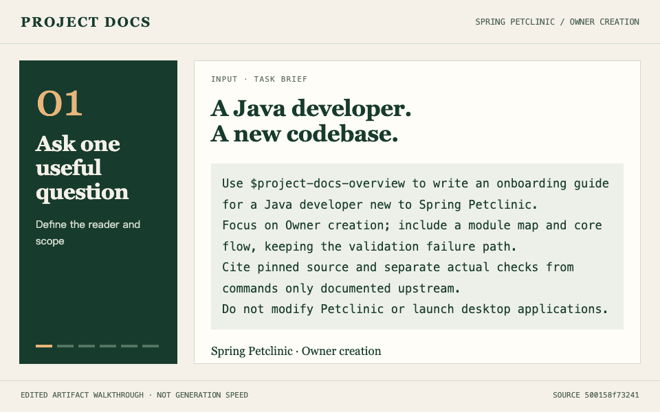

<!-- Launch draft. Not published. Author: Jeff.Liu -->
# An onboarding guide you can check against the code

Opening an unfamiliar Spring Boot project tells you which frameworks it uses. It does not tell you where to start reading, how a request moves through the application, or whether an explanation matches the code.

I built [Project Docs](https://github.com/ainiaa/skills-project-docs), an open-source collection of Skills for Codex and Claude Code. It supports onboarding guides, PRDs, API documentation and editable diagrams. A small, concrete workflow is a useful place to start.

Here is a walkthrough of Owner creation in the public Spring Petclinic sample:



*An edited 24-second walkthrough of existing outputs, not real-time generation speed.*

The outputs include a reading order for a new developer, an onboarding guide, module and flow diagrams, and links to a pinned source revision. Details matter: this path calls the JPA repository directly from the controller. Invalid input returns to the form; successful submission saves the owner and redirects to the detail page.

You can inspect the [worked case](https://github.com/ainiaa/skills-project-docs/blob/main/docs/examples/petclinic/README.en.md) and [full guide](https://github.com/ainiaa/skills-project-docs/blob/main/docs/examples/petclinic/developer-guide.en.md) before installing anything.

To try it with Git, Python 3.11+ and Node.js/npm available, start with Mermaid:

```bash
git clone https://github.com/ainiaa/skills-project-docs.git
cd skills-project-docs
bash install.sh --host codex --engine mermaid
bash install.sh --doctor --host codex --engine mermaid
```

For Claude Code, replace `--host codex` with `--host claude`. The installer prepares the selected engine's tools; see the [setup requirements](https://github.com/ainiaa/skills-project-docs/blob/main/README.md#quick-start). In a project you are authorized to use, ask:

> Use project-docs-overview to explain Owner creation to a Java developer joining this project. Include a reading order, the main flow, validation failures, source references and unverified steps.

The case preserves an earlier run of 18 passing controller tests using MockMvc and a mocked repository. It does not establish database persistence or browser end-to-end correctness; those tests were not rerun for these launch materials. No time savings were measured.

Feedback on installation friction, the usefulness of the first document, and unsupported claims would help. Please share a sanitized example in [Issues](https://github.com/ainiaa/skills-project-docs/issues).
