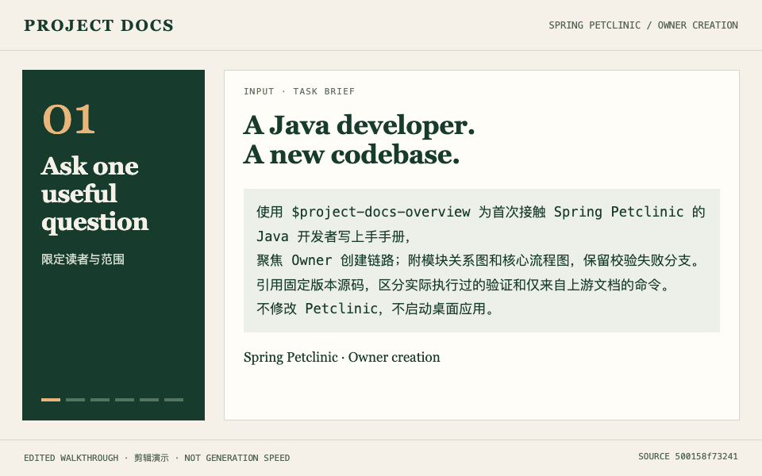

<!-- 首发草稿，未发布。作者：Jeff.Liu -->
# 接手陌生 Spring Boot 项目，先找到一条能核对的上手路线

接手项目时，知道“用了 Spring Boot 和 JPA”并不等于知道从哪里读代码。新人真正需要的是：先看什么、一条业务链路怎么走、哪些结论有源码依据。

我做了 [Project Docs](https://github.com/ainiaa/skills-project-docs)，一套供 Codex 和 Claude Code 使用的开源 Skills，支持上手文档、PRD、接口文档与可编辑技术图。第一次尝试可以只选一个具体功能。

下面是公开 Spring Petclinic 的 Owner 创建流程走读：



*24 秒剪辑演示，展示现有成果，不代表实时生成速度。*

这份案例交付了新人阅读路线、上手手册、模块关系图、核心流程图及可回查的源码链接。一个细节是：这条链路由 Controller 直接调用 JPA Repository，图里就保留这个结构；字段校验失败回到表单，成功后才保存并跳转到详情页。

可以直接打开[完整案例](https://github.com/ainiaa/skills-project-docs/blob/main/docs/examples/petclinic/README.md)和[上手手册](https://github.com/ainiaa/skills-project-docs/blob/main/docs/examples/petclinic/developer-guide.md)，先判断成果是否有用，再决定是否安装。

想自己试，在已具备 Git、Python 3.11+、Node.js/npm 的环境中，从 Mermaid 引擎开始：

```bash
git clone https://github.com/ainiaa/skills-project-docs.git
cd skills-project-docs
bash install.sh --host codex --engine mermaid
bash install.sh --doctor --host codex --engine mermaid
```

Claude Code 用户将 `--host codex` 换成 `--host claude`。安装器会准备所选引擎所需工具；更多环境要求见[安装说明](https://github.com/ainiaa/skills-project-docs/blob/main/README.zh-CN.md#安装与升级)。然后在有权使用的项目目录中发起：

> 用 project-docs-overview 给新加入的 Java 开发者整理 Owner 创建流程的上手文档，包含阅读顺序、主链路、校验失败路径、源码依据和未验证项。

案例保留了固定源码提交及此前实际通过的 18 项 Controller 测试记录；这些是 MockMvc 与模拟 Repository 的测试，不覆盖真实数据库持久化或完整浏览器端到端流程。本次准备首发材料没有重新运行上游测试，也没有测量节省时间。

如果你也在接手项目，欢迎先用一个可分享的功能尝试。最希望了解三件事：安装卡在哪、第一份文档是否有用、哪条结论找不到依据。可以在[仓库 Issues](https://github.com/ainiaa/skills-project-docs/issues)留下脱敏反馈。
