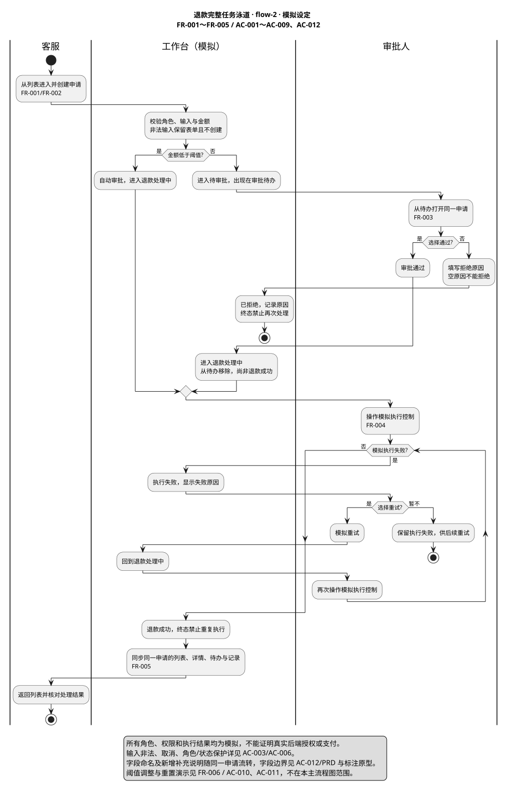

# 退款工作台 · 完整流程模拟示例

> 产品版本：flow-2
> 状态：草稿
> 文档修订：flow-2-doc-3，补充计算说明与场景引导；业务规则、五个页面/弹窗及交互版本 flow-2 保持不变。

## 业务摘要与阅读导航

本次在已有退款流程中新增选填“补充说明”，让客服与审批人看到同一笔申请的信息；“客户”统一显示为“客户 / 企业名称”。原有金额、审批、执行及重试规则保持不变。以下均为模拟需求，实际业务价值尚待确认。

### 角色阅读区

| 读者 | 本次变化与影响 | 现在需要判断什么 | 查看依据 |
|---|---|---|---|
| 业务人员 | 创建申请时新增选填说明，后续处理可查看；客户字段改名，不改变原审批职责 | 这些变化是否解决实际信息缺失，名称是否合适，历史申请不补填是否可接受；尚无调研或效果基线 | [字段前后变化](#页面与字段变更)、[核心流程](#核心流程速览)、[交互原型](prototype.html)及[新增规则](#ac-012-补充说明及字段命名的增量回归) |
| 研发人员 | 创建和共享详情增加说明；旧记录缺字段与新记录空值分开显示，原校验及分流保持 | 真实存储/接口/消费者影响未核实；业务适用范围待确认，具体实现由技术设计核实，当前不构成生产实施依据 | [现状依据](#src-002-本次实际示例基线及增量设定)、[历史影响](#变更前后与历史影响)、[FR-002](#fr-002-客服创建退款申请) |
| 测试人员 | 核对字段流转、命名、旧行为和新旧记录；覆盖空值、边界、角色与失败恢复 | 准备历史缺字段、新空值、有效/超限输入及同一申请跨角色数据；生产数据条件尚未核实 | [AC-012](#ac-012-补充说明及字段命名的增量回归)、[原有回归](#需求与验收)、[完整旅程](#流程覆盖表) |

### 核心流程速览

[可编辑图源](refund-swimlane.puml) · [放大查看](refund-swimlane.svg) · [走一遍交互流程](prototype.html)。图示复用下文正式规则：审批通过进入处理中，模拟执行成功才是最终成功；新增说明随同一申请保留。

## 背景、目标与范围

本例演示本期退款业务从申请列表到结束结果的完整用户任务，用于评审产品交接和交互完整性。所有客户、订单、金额、权限、阈值和执行结果都是模拟设定，不代表真实业务确认。

覆盖申请列表、创建、详情、角色交接、审批、退款执行成功或执行失败后的重试，以及操作记录和跨视图联动。使用自包含 HTML 和共享内存数据，刷新或重置会丢失本次演示变更。登录、真实权限、实际支付、订单校验、持久化及统计报表不在本例范围。

## 目标用户与场景

客服希望发起申请并跟踪处理结果；审批人希望接收待办、完成审批并核对模拟执行结果。两类角色及权限均为演示设定，不代表真实岗位授权。

本期 FR-001 至 FR-005 为 P0 模拟建议，保障申请到结果及记录的主流程；FR-006 为 P1 模拟建议，用于规则比较和重置演示。优先级不是产品确认或排期承诺。

## 来源与决策

### SRC-002 本次实际示例基线及增量设定

本节基线摘录记录本轮修改前 flow-1 / flow-1-doc-3 的实际显示名、缺字段状态及原文件 SHA-256；不是生产系统截图或真实用户调研。本次模拟增量：新增选填补充说明，最多200个UTF-16码元；客户显示名统一为“客户 / 企业名称”，原数据与40码元校验保持不变。规则详见 FR-002/AC-012，不接真实接口、不新增真实岗位授权。

来源：本仓库本轮修改前的退款示例 flow-1 / flow-1-doc-3；这是实际示例文件的摘录，不是生产系统、真人岗位或真实支付规则。未核实真实业务，不宣称生产差异已覆盖。

- 创建、列表、审批待办、详情原显示名均为“客户”；40 个 UTF-16 码元校验。
- 原创建表单及申请对象无“补充说明”字段；三笔初始记录保留缺字段状态。
- 原有金额、阈值、审批、执行、重试及角色约束保持不变。

原 HTML SHA-256：0130ce2e534786474506ce514db23bc654bf4aa82249e4b0eaa193f7a2cdc68b

原 PRD SHA-256：c667bf50519637ee7b8b8e93de56e813684a244484d674dcef46cdb70427a776

摘录用于核对模拟增量，不是整份旧界面的重建或完整旧图导出。实际原文件快照由本轮任务起点 Source Receipt 绑定。

### SRC-001 本集合的模拟评审设定

默认人工审批阈值 500.00 元；有效金额大于零、至多两位小数、换算为分后不超过 JavaScript 安全整数。小于阈值自动审批通过并进入退款处理中；达到阈值进入待审批。客服创建和查看申请，审批人审批；模拟执行控制仅在审批人角色可操作。角色切换只是界面演示，不证明真实服务端权限。

拒绝必须填写原因。审批通过仅表示进入退款处理中；模拟执行成功才显示退款成功。执行失败可以模拟重试并回到处理中；成功、拒绝均为终态，禁止重复操作。模拟阈值变更只影响之后创建的申请，不追溯改变已有申请。初始提供三笔标明为模拟的申请，重置恢复它们及默认阈值、角色和筛选。

以上均为可逆的示例规则；真实项目必须由业务方确认实际版本。

### 计算核对

输入为以元表示的正数十进制文本，至多两位小数；按整数分比较，不进行舍入。公式为整数元部分 × 100 + 补足两位的小数部分，结果不得超过安全整数 9007199254740991。例如 499.99 × 100 = 49999，小于默认阈值 50000 分，进入处理中；500.00 × 100 = 50000，达到阈值进入待审批；500.01 为 50001 分，也需审批。0、负数、科学计数、超精度及超安全范围输入拒绝，见 AC-002/AC-003。阈值修改只作用于新申请，见 AC-010。

## 变更前后与历史影响

这是本集合的模拟功能，未提供真实历史系统、生产代码或在途数据；真实系统的技术影响待核实。以下是对模拟规则的回归约束，不代表已完成生产影响分析。

| 关联 FR | 变更前后与依据 | 影响和历史/进行中处理 | 回归与缺口 |
|---|---|---|---|
| FR-001～FR-005 | 本例覆盖从申请到结果的完整任务；依据 SRC-001，无真实旧版本行为证据 | 列表、详情、待办与记录使用同一对象；处理中对象的模拟审批/执行受状态限制 | AC-001～AC-009；真实接口、消息与旧流程待核实 |
| FR-006 | 演示可调整默认 500.00 元阈值，具体规则见 FR-006/SRC-001 | 只影响之后创建的申请；历史及进行中模拟申请保留原状态，不重新审批 | AC-010；生产切换和历史迁移规则待确认 |

### 页面与字段变更

| 页面/字段 | 类型及基线 | 目标与关联 | 历史及回归 |
|---|---|---|---|
| 创建、详情/补充说明 | 新增；原示例无字段，见 SRC-002 | 输入与显示见 FR-002/AC-012 | 旧申请缺字段不回填；新空值与旧缺字段区分；跨角色和终态保持 |
| 列表、待办、创建、详情/客户 | 修改显示名；原名“客户”，见 SRC-002 | “客户 / 企业名称”；原40码元与数据不变，FR-001/FR-002 | AC-001、AC-003、AC-012；不改变原搜索和角色规则 |
| 金额、审批、执行、设置 | 相关保持不变；SRC-001 | FR-001～FR-006 原规则 | AC-001～AC-011 保留回归 |

本次没有删除入口。真实查询/导出/报表/接口/存储是否涉及新字段待核实，不能声称生产技术影响已经覆盖。原型只在创建输入和共享详情展示补充说明，不默认给列表、搜索或导出新增字段。

## 需求与验收

### FR-001 申请列表与详情入口
状态：草稿
依据：SRC-001
原型：是

从工作台查看申请列表、按申请号/订单号/客户搜索、按状态筛选，并打开同一申请详情。返回后仍能核对该申请。无结果时显示可恢复的空状态。

#### AC-001 查找、详情和返回
搜索某笔申请，打开详情核对相同 ID、订单、客户与金额，返回列表；搜索无结果时显示提示，清除搜索恢复数据。

#### AC-013 场景引导与紧凑移动端

折叠的场景引导提供自动审批、人工拒绝和失败重试三条路线，说明角色、起点及结束结果。前往起点仅导航和切换模拟角色，不自动创建、审批或执行。没有适用状态的申请时提示创建或确认重置，不偷偷生成数据。退出引导不改变申请，重置后可重新选择。390px 窄屏压缩辅助指标后，首笔申请起点在首屏可见，仍可键盘操作及查看详情。

### FR-002 客服创建退款申请
状态：草稿
依据：SRC-001 SRC-002
原型：是

填写订单号、客户、金额和申请原因；订单号与客户名各 1～40 个计数单位，申请原因 1～200 个计数单位。文本去除首尾空白后按 UTF-16 码元计数，与本模拟 HTML 的 String.length 一致；这不是已确认的真实产品字符口径。显示文本不执行 HTML。客服有效提交后生成稳定申请 ID，并进入对应状态及详情。审批人创建入口禁用。取消或非法输入不产生申请。

#### AC-002 正常自动审批路径
客服提交 200.00 元，自动审批通过并进入退款处理中；不是退款成功。0.01 和 499.99 也走该路径。

#### AC-003 非法输入及取消
空值、零、负数、科学计数、超过两位小数或非安全金额不能提交；缺少订单、客户或原因同样不能提交。显示错误，列表数量不变。取消或 Escape 关闭表单不增加记录。客户名中的 HTML 文本仅作为文字显示。订单号/客户名各 40 个计数单位、申请原因 200 个计数单位可提交；对应 41/201 超限不能创建，原输入保留并可修正。纯首尾空白去除后为空则拒绝；补充字符按 UTF-16 两个码元计数，真实产品口径仍需业务确认。

补充说明是独立的选填字段，不替代必填申请原因，不影响审批分流；对应新增和命名差异的完整规则及预期见 AC-012。

#### AC-012 补充说明及字段命名的增量回归

创建表单新增选填“补充说明”，去除首尾空白后最多 200 个 UTF-16 码元，计数口径同 FR-002；201 超限显示错误、保留输入且不创建申请，修正至 200 后可提交。输入时显示当前计数和上限，超限显示超出量，说明普通汉字计1、部分表情（如😀）计2；新建表单计数重置为0，保存校验仍采用相同裁剪和计数口径。新记录为空显示“未填写”；初始历史申请缺字段显示“历史申请未提供”，不自动回填。提交的说明以文字展示，围绕同一申请 ID 在客服详情、审批人详情及执行失败/重试/最终结果中保留。“客户”改名为“客户 / 企业名称”，列表、待办、创建和详情保持原数据及 40 码元校验；该命名调整不新增真实授权。使用与标注模式切换不修改业务数据或清除输入。所有新增规则为模拟设定，真实业务待确认。

### FR-003 人工审批与角色交接
状态：草稿
依据：SRC-001
原型：是

达到阈值的申请进入待审批；审批人在待办中打开同一申请，选择通过或填写原因后拒绝；拒绝原因去除首尾空白后须为 1～200 个计数单位，计数口径复用 FR-002。客服和非待审批状态不能审批，动作检查不能只依赖按钮禁用样式。

#### AC-004 边界申请与通过
客服提交 500.00 元，显示待审批；切换审批人，从待办找到同一 ID，通过后进入退款处理中，从待办移除。

#### AC-005 填写原因后拒绝
对另一笔待审批申请，空原因或去除首尾空白后为空不能拒绝；200 个计数单位的原因可拒绝并进入已拒绝，记录保存去除首尾空白后的原因。201 超限时保留输入、显示错误且申请仍待审批；修正后可以继续。拒绝后不能再次审批或模拟执行。

#### AC-006 角色和状态保护
客服不能审批或操作模拟执行；审批人不能创建申请。切换角色保留当前申请。处理中的申请不能再次审批，终态不能重复执行或重试。

### FR-004 模拟执行与失败恢复
状态：草稿
依据：SRC-001
原型：是

审批人在明确标识的模拟控制区将处理中的申请设为成功或执行失败。执行失败后可模拟重试，回到处理中；再次成功后为终态。每次转换记录前后结果。

#### AC-007 执行成功
处理中的申请模拟执行成功，显示退款成功，成功/失败/重试操作全部禁用；审批通过不能提前显示成功。

#### AC-008 执行失败、重试并成功
处理中的申请模拟执行失败，显示失败原因；重试后回到处理中，随后模拟成功。记录按顺序保留失败、重试及成功。

### FR-005 跨视图一致性与操作记录
状态：草稿
依据：SRC-001
原型：是

列表、详情、审批待办、数量指标及操作记录使用同一份模拟申请数据。记录包含动作、角色、时间和结果，业务操作不会删除历史；演示重置除外。

#### AC-009 同一申请贯穿完整旅程
围绕同一申请 ID 完成创建、审批、执行失败、重试、成功，再返回列表核对结果；待办不再含该申请，操作记录包含按顺序发生的动作。其他申请保持原状态。

### FR-006 模拟设置与重置
状态：草稿
依据：SRC-001
原型：是

演示设置与业务表单区分，任何角色可调整模拟阈值。非法参数不保存；合法参数只作用于后续新申请。重置需确认，恢复三笔初始数据、默认角色和 500.00 阈值。

#### AC-010 规则变化不改写历史
先提交 800.00 元进入待审批；阈值改为 1000.00 后，旧申请仍待审批，新建 800.00 元进入处理中，新建 1000.00 元待审批。零等非法阈值不保存。

#### AC-011 重置与窄屏操作
确认重置后只保留三笔初始模拟申请，默认角色、筛选及阈值恢复；取消重置不改变数据。窄屏可完成创建和查看详情，长表格在自己的容器内滚动，不撑开整页。

## 交互与原型

[打开完整流程原型](prototype.html)。这是完整用户任务原型；真实支付等范围外步骤由明确标识的模拟控制衔接。

首次体验可展开“场景引导”，选择路线并前往起点，按提示手动完成操作及核对结果；默认折叠，不遮挡业务任务。引导不改变审批或退款规则。

### 使用模式与变更标注模式

[交互 HTML](prototype.html)默认使用模式；顶部或创建弹窗中的“显示变更标注”打开同一页面的新增/修改说明，可定位正式 PRD 的 FR/AC 与 SRC-002 基线。切换不更换对象、清除输入或改变状态；键盘可操作标注开关和业务控件。没有两套可独立修改的页面。使用模式及标注模式截图来自当次真实浏览器，见交付证据，不以本文件预先宣称已通过。

### 页面清单与跳转关系

| 页面标识及形态 | 本次处理 | 角色与入口 | 去向及关键状态 | FR/AC |
|---|---|---|---|---|
| requests / 申请列表 | 修改客户显示名 | 客服/审批人，从导航进入 | 创建弹窗、同一申请详情；搜索/筛选/空状态 | FR-001 / AC-001 |
| create / 创建弹窗 | 新增说明、修改客户显示名 | 客服，从列表顶部进入 | 取消回列表；有效提交进详情；非法保留输入 | FR-002 / AC-002 AC-003 AC-012 |
| detail / 申请详情 | 新增说明、修改客户显示名；保留操作区 | 客服从列表、审批人从待办进入同一对象 | 原详情包含审批/执行/结果/记录；失败可重试，返回对应列表 | FR-002～FR-005 / AC-004～AC-009 AC-012 |
| approvals / 审批待办 | 修改客户显示名 | 审批人从导航进入 | 打开详情处理；审批后移出待办 | FR-001 FR-003 / AC-001 AC-004 AC-006 |
| settings / 设置弹窗 | 未变衔接 | 两种模拟角色从顶部进入 | 保存或取消返回原业务视图，历史不重算 | FR-006 / AC-010 |

本例沿用真实旧示例的弹窗及共享详情结构，不额外伪造独立审批/执行页面。HTML 文件为一个，业务页面/弹窗为五个；刷新清除内存是已声明边界。

### 流程覆盖表

| 旅程 | 角色及角色交接 | 入口、步骤与页面 | 结束结果 | 异常及恢复 | FR / AC / 浏览器证据 |
|---|---|---|---|---|---|
| 自动审批及执行 | 客服 → 审批人模拟执行 | 申请列表 → 创建 → 详情 → 执行 → 返回列表 | 退款成功及记录 | 非法输入、取消、非授权角色 | FR-001 FR-002 FR-004 FR-005 / AC-001 AC-002 AC-003 AC-006 AC-007 AC-009 / `test_product_browser.mjs`，以实际运行回执为准 |
| 人工审批及执行 | 客服 → 审批待办中的审批人 | 创建 → 待办 → 同一申请详情 → 通过 → 执行 → 列表 | 待办移除、退款成功 | 边界 500，禁止重复审批 | FR-003 FR-004 FR-005 / AC-004 AC-006 AC-007 AC-009 / 同上 |
| 拒绝处理 | 客服 → 审批人 | 创建 → 待办 → 详情 → 填原因拒绝 → 记录 | 已拒绝并保留原因 | 空原因不改变状态 | FR-003 FR-005 / AC-005 AC-006 AC-009 / 同上 |
| 执行失败及恢复 | 审批人 | 处理中详情 → 模拟执行失败 → 重试 → 模拟成功 → 列表与记录 | 退款成功，保留失败及重试历史 | 非失败状态不能重试 | FR-004 FR-005 / AC-008 AC-009 / 同上 |
| 设置、重置及窄屏 | 两种模拟角色 | 演示设置 → 新申请 → 对比旧申请；确认重置 | 新规则生效、历史不变；重置回初始值 | 非法参数、取消确认、窄屏溢出 | FR-006 / AC-010 AC-011 / 同上 |

新增补充信息旅程：列表 → 创建（填写或不填补充说明）→ 同一申请详情 → 审批待办 → 详情审批 → 执行失败/重试/成功 → 返回列表再打开详情，补充信息保持；对应 FR-002/AC-012，与 AC-009 共用对象。

## 图表索引与一致性

以下图均为 flow-2 的模拟业务说明，以 SRC-001 和对应 FR/AC 为依据；不是生产调用链。主泳道展示申请到结束及失败恢复；时序侧重审批与模拟执行失败/重试，未定义真实异步服务。

| 图 | 可编辑图源 / 实际导出 | 对应需求与场景 |
|---|---|---|
| 核心任务泳道 | [PlantUML](refund-swimlane.puml) / [SVG](refund-swimlane.svg) | FR-001～FR-005；AC-001～AC-009、AC-012，非法/取消/权限保护见图注及正文 |
| 业务时序 | [PlantUML](refund-sequence.puml) / [SVG](refund-sequence.svg) | FR-002～FR-005；AC-002、AC-004～AC-009、AC-012，侧重角色交接及失败恢复 |

两图、FR 与 [交互 HTML](prototype.html) 共用阈值判定、审批通过仍在处理中、执行失败可重试和终态禁止重复操作等规则。具体模拟值以 SRC/FR 为准。渲染、视觉、浏览器与语义评审分开报告，图文件存在不代表业务确认。

## 非功能、依赖与约束

- 安全与角色边界：输入作为文本显示，拒绝非法输入和模拟越权动作；演示不能证明真实鉴权、审计或支付安全，后端仍需独立校验。
- 一致性与可用性：所有视图引用同一内存申请对象，失败后保留记录；刷新会丢失变更，不提供持久化与真实可用性 SLA。
- 兼容与性能：本例需验证窄屏、键盘和目标浏览器；没有真实负载基线、QPS 目标或压测结果，不补造性能承诺。
- 外部依赖：真实订单、身份及支付接口均未接入，原型只使用明确标识的模拟数据。

## 时间计划与里程碑

真实产品交付及上线均未排期。本例的关键用例以流程覆盖表引用 FR/AC，主流程、角色交接和异常恢复不另抄一套业务规则。

## 未决事项

无实际业务确认项；整份材料保持草稿。真实项目须重新确认模拟角色、阈值、失败恢复和执行边界。

## 评审、变更与研发交接

### 证据区

按当次实际结果记录结构、浏览器旅程、模型内容评审及人工确认，集中链接检查证据；尚无本次回执的项目写未验证，不在规则正文重复运行过程。结构校验检查版本、标识和静态资源；浏览器验收核对完整旅程及对象联动；模型评审检查交付范围和业务表达。各自按当次真实证据报告，不以编号齐全代替完整性，也不以本示例批准真实研发或资金执行。

### 交接结论

适用版本：flow-2；文档修订：flow-2-doc-3。本表说明当前材料可用于什么，不代表真实岗位已经评审或签字。

| 用途 | 当前结论 | 依据与阻塞 | 下一步／决定人 |
|---|---|---|---|
| 业务评审 | 可讨论模拟草稿；尚未获得真实业务确认 | [本次字段变化](#页面与字段变更)已明确；实际信息缺失、字段名称和历史不补填是否合适仍需确认，无真实效果基线 | 业务负责人确认适用场景及规则；具体负责人待指定 |
| 技术设计 | 可讨论示例设计；真实系统的对应设计仍缺输入，尚不能据此实施 | [FR-002](#fr-002-客服创建退款申请)及[历史影响](#变更前后与历史影响)提供目标约束；业务适用范围待决定，真实存储、接口和下游影响待核实 | 业务负责人补适用范围；研发负责人补现状证据与技术设计，具体人员待指定 |
| 测试准备 | 可按模拟规则准备示例用例；不能据此认定生产验收通过 | [AC-012](#ac-012-补充说明及字段命名的增量回归)和[完整旅程](#流程覆盖表)定义边界与回归；真实历史数据、账户权限及支付结果未核实 | 测试负责人准备新旧记录与边界数据，业务确认未知预期，研发补接口和环境条件；具体人员待指定 |

真实人员试读：未验证；生产影响核查：未验证；生产联调：未验证。结构检查、浏览器旅程和模型内容评审仅按本次交付的实际验收记录报告，不由本表预先判定通过。
